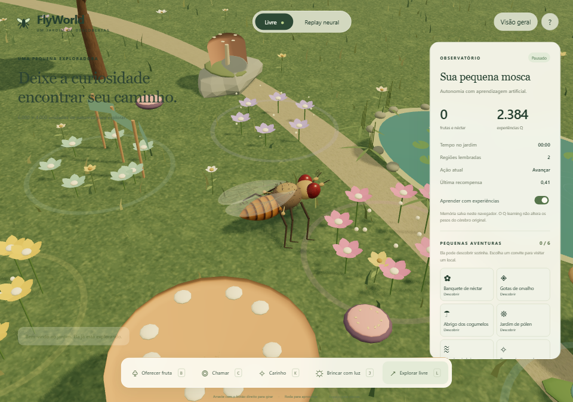
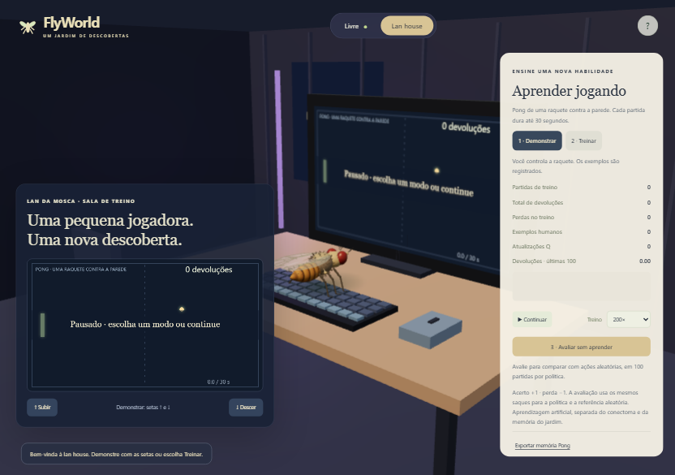

<div align="center">

# 🪰 FlyWorld

### Um pequeno ser. Um grande mundo para descobrir.

Um jardim 3D onde uma mosca explora, interage e aprende com as próprias experiências.

[](https://flyworld-garden.vercel.app)
[](requirements-flyworld.txt)
[](web/package.json)
[](LICENSE)

[**Abrir FlyWorld ↗**](https://flyworld-garden.vercel.app) · [Instalação local](#-execute-no-seu-computador) · [Documentação](#-para-explorar-o-projeto)

</div>



## 🌿 Conheça sua pequena exploradora

O FlyWorld transforma um jardim em um espaço de descoberta: árvores, flores, lagos, frutas e caminhos em um mundo de **6.000 × 4.000 unidades**. Acompanhe uma mosca com asas translúcidas, olhos detalhados e pernas animadas enquanto ela percorre o ambiente.

O visual naturalista traz olhos facetados, cerdas e asas com nervuras, árvores com galhos e folhas, flores curvas e água com reflexos. A luz quente e as texturas locais dão mais profundidade ao jardim. Veja os [detalhes do visual e as referências](docs/VISUAL_NATURALISTA.md).

Você pode apenas observar ou participar da experiência: oferecer uma fruta, chamá-la para perto, fazer carinho e brincar com luz. O mapa ajuda a acompanhar os lugares visitados, enquanto o painel mostra o progresso da aprendizagem.

## ✨ O que você encontra por aqui

| Recurso | Como funciona |
| --- | --- |
| **Mundo 3D** | Jardim amplo, câmera ajustável, vegetação, lagos e minimapa. |
| **Exploração autônoma** | A mosca escolhe ações, encontra comida e registra regiões visitadas. |
| **Aprendizagem artificial** | Q-learning ajusta a política de ações usando recompensas das experiências. |
| **Memória persistente** | Progresso salvo no navegador; no Python, em um arquivo JSON local. |
| **Interações** | Oferecer fruta, chamar, fazer carinho, brincar com luz e retomar a exploração. |
| **Replay neural real** | Visualização de spikes gravados, com identificação da origem dos dados. |
| **Cérebro ao vivo no jardim 3D** | Brian2 local recebe alimento e gera avanço pelo decoder P9 experimental, sem agente artificial assumir. |
| **Versão local** | Integração com Brian2 e biblioteca de gravações verificadas por SHA-256. |

## 🎮 Entre no jardim

**[Acesse flyworld-garden.vercel.app](https://flyworld-garden.vercel.app)** — sem instalação.

Na versão web:

- O modo inicial **Cérebro ao vivo** aguarda o serviço local. Execute `iniciar-cerebro-3d.cmd` e use o endereço aberto para conectar o Brian2. No site público, selecione **Agente artificial** para explorar sem o serviço.

- Use os botões inferiores para interagir com a mosca.
- Clique no cenário para oferecer fruta e no mapa para chamá-la até um ponto.
- Arraste com o botão direito para girar a câmera e use a roda para aproximar.
- Use as setas para controlar o movimento e **Espaço** para pausar quando o foco estiver no cenário.
- Alterne entre **Cérebro ao vivo**, **Agente artificial** e **Replay neural** no topo. Setas e interações guiadas pertencem ao agente artificial.
- No celular, abra **Painel** para ver as informações da simulação.

A memória pertence ao navegador utilizado. Limpar os dados do site remove esse progresso; use **Exportar memória**, na janela de informações, para guardar uma cópia.

## 🖥️ Lan da Mosca — ensine uma nova habilidade

Selecione **Agente artificial** e depois **Lan house** no topo para visitar uma sala 3D separada, com a mosca diante de um computador jogando Pong. O jardim fica preservado enquanto você estiver lá.

1. **Demonstrar:** você controla a raquete com as setas ou botões de toque; seus exemplos são registrados.
2. **Treinar:** a mosca escolhe ações e aprende por recompensa. É possível acelerar e acompanhar as estatísticas.
3. **Avaliar:** compare a política congelada com ações aleatórias, em 100 episódios por política e com os mesmos saques reservados.

A memória de Pong é independente e exportável. O jogo é de uma raquete contra a parede, com episódios de até 30 segundos. No [experimento registrado](docs/PONG_EVALUATION.json), 15 mil partidas de treino levaram a 2,36 devoluções por episódio, contra 0,39 da referência aleatória. Sua sessão começa sem esse treino: o resultado depende das experiências e demonstrações.

[Como ensinar, treinar e avaliar](docs/LANHOUSE_PONG.md)



## 🦋 Seis pequenas aventuras no jardim

Encontre **flores com néctar, gotas de orvalho, abrigo de cogumelos, pólen, uma clareira com brisa e vaga-lumes**. Cada local tem objetos próprios e uma experiência que aparece no diário de descobertas.

As experiências agora ficam em regiões distintas, conectadas por caminhos: campo de flores, margem do lago, bosque, jardim de pólen, clareira e recanto dos vaga-lumes. Frutas aparecem em grupos e as árvores formam bosques.

A mosca pode encontrar esses locais ao explorar. Abra **Pequenas aventuras** no painel para convidá-la a visitar um deles. Colete pólen e depois visite o néctar para completar uma entrega; o pólen aparece no corpo da mosca durante o caminho.

As descobertas, o diário e as entregas ficam salvos no navegador. Veja o [guia das experiências](docs/EXPERIENCIAS_JARDIM.md).

## 🧠 Aprendizagem e dados neurais

O novo modo **Cérebro ao vivo** usa o Brian2 completo como fonte dos comandos de avanço no jardim 3D. Sensores de alimento estimulam Sugar GRNs; spikes P9 são decodificados em movimento. Sem saída motora, o corpo fica parado. A calibração P9 é um protocolo explícito de estimulação direta. **Ainda não há giro validado, aprendizagem neural ou exploração independente pelo conectoma.** Veja [como iniciar e o que foi medido](docs/CEREBRO_AO_VIVO.md).

O modo **Agente artificial** (antigo Livre) usa **Q-learning artificial** para atualizar decisões a partir de exploração, comida e colisões. Essa memória é separada dos pesos do conectoma biológico.

A versão web também oferece **seis amostras de gravações neurais reais**, extraídas do pacote `nature_2026_07`: estímulo de açúcar a 200 Hz, duração de 1 segundo e trial 0, em seis backends. Os arquivos públicos incluem o SHA-256 dos Parquets originais; o raster exibe uma amostra dos neurônios mais ativos.

**O replay reproduz dados gravados.** Brian2 executa no computador local, conectado ao navegador pelo novo serviço. No aplicativo Pygame anterior, o modo autônomo mantém o observador assíncrono. A aprendizagem artificial não modifica os pesos da rede. As respostas de carinho e brincadeira são comportamentos programados.

Saiba mais sobre [aprendizagem](docs/MODO_LIVRE_APRENDIZAGEM.md) e [biblioteca neural](docs/BIBLIOTECA_NEURAL.md).

## 🚀 Execute no seu computador

### Versão web

Requer Node.js compatível com Vite 8 — por exemplo, Node.js 24, usado na publicação.

```bash
git clone https://github.com/otaviorodriguess/FlyWorld.git
cd FlyWorld/web
npm ci
npm run dev
```

Abra o endereço exibido pelo Vite no terminal. Para gerar os arquivos de produção, execute `npm run build`.

Para conectar o cérebro completo ao jardim 3D, após instalar também as dependências Python abaixo, execute **`iniciar-cerebro-3d.cmd`** na raiz e abra **http://127.0.0.1:8765**. O serviço aguarda blocos neurais reais; ele não roda na Vercel. [Guia do cérebro ao vivo](docs/CEREBRO_AO_VIVO.md).

### Aplicativo Python

Requer **Python 3.10+**. Os comandos abaixo usam PowerShell no Windows, a partir da raiz do repositório:

```powershell
python -m venv .venv
.\.venv\Scripts\python -m pip install -r requirements-flyworld.txt
.\.venv\Scripts\python -m flyworld
```

Para explorar com aprendizagem artificial sem iniciar o observador Brian2:

```powershell
.\.venv\Scripts\python -m flyworld --no-neural-observer
```

No Linux/macOS, use `.venv/bin/python`. Os controles do aplicativo local estão no [guia completo](FLYWORLD_README.md). O ZIP completo das gravações é obtido separadamente e não acompanha este repositório.

## 🛠️ Por dentro do FlyWorld

| Pasta | Conteúdo |
| --- | --- |
| [`web/`](web/) | Mundo Three.js, interface, aprendizagem no navegador e configuração Vercel. |
| [`flyworld/`](flyworld/) | Aplicativo Python, corpo virtual, sensores, aprendizagem e integração neural. |
| [`tests/`](tests/) | Testes do aplicativo Python. |
| [`docs/`](docs/) | Guias, relatórios e imagens. |
| [`code/`](code/) | Implementações e ferramentas do projeto científico original. |
| [`data/`](data/) | Dados e metadados herdados da base científica. |

### Verificação

Na raiz do projeto, com as dependências instaladas:

```powershell
.\.venv\Scripts\python -m pytest tests -q
cd web
npm test
npm run build
```

A validação desta versão passou em **33 testes Python na versão local e 23 testes web**, além do build de produção e da navegação automatizada em tamanhos de tela de computador e celular. Veja os [detalhes da publicação](docs/DEPLOY_VERCEL.md).

## 📚 Para explorar o projeto

- [Instalação, modos e controles do Python](FLYWORLD_README.md)
- [Mundo 3D e câmera](docs/MUNDO_3D.md)
- [Jardim e interações](docs/JARDIM_INTERACOES.md)
- [Autonomia e aprendizagem](docs/MODO_LIVRE_APRENDIZAGEM.md)
- [Biblioteca e gravações neurais](docs/BIBLIOTECA_NEURAL.md)
- [Lan house e aprendizagem de Pong](docs/LANHOUSE_PONG.md)
- [Publicação na Vercel](docs/DEPLOY_VERCEL.md)
- [Documentação científica original](README_UPSTREAM.md)

## 🤝 Autoria, créditos e licença

O FlyWorld é desenvolvido neste repositório de [Otávio Rodrigues](https://github.com/otaviorodriguess), a partir da base científica [eonsystemspbc/fly-brain](https://github.com/eonsystemspbc/fly-brain). O histórico original e seus créditos foram preservados.

Projeto distribuído sob a [licença GPL-2.0](LICENSE). Consulte também as licenças presentes nos componentes do projeto original.

<div align="center">

**A próxima descoberta começa com um pequeno passo.**

[🌿 Visitar o jardim](https://flyworld-garden.vercel.app)

</div>
