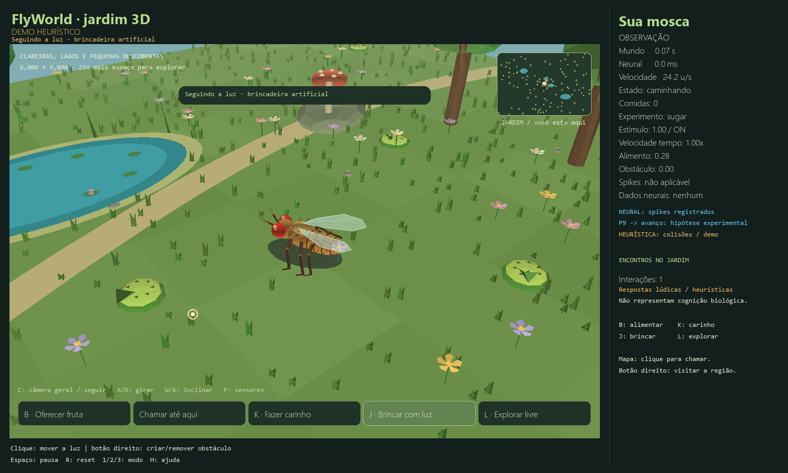

# FlyWorld — um jardim de descobertas

[Abra o mundo 3D no navegador](https://flyworld-garden.vercel.app)

Uma mosca em um jardim de 6.000 × 4.000 unidades, com exploração autônoma, interações e aprendizagem artificial persistente.

- **Web:** visualização Three.js, frutas, carinho, chamadas, brincadeiras com luz, mapa e memória salva no navegador.
- **Python:** simulador Pygame, Q-learning, biblioteca de gravações verificadas por SHA-256 e integração com o cérebro Brian2 como observador assíncrono.
- **Dados neurais reais:** seis amostras públicas de replay. O cérebro completo executa no aplicativo local. A aprendizagem artificial não modifica os pesos do conectoma.

## Executar

Veja [instalação e controles do aplicativo Python](FLYWORLD_README.md) e [desenvolvimento e publicação da versão web](docs/DEPLOY_VERCEL.md).

```powershell
cd web
npm ci
npm run dev
```

## Verificar

```powershell
python -m pytest tests -q
cd web
npm test
npm run build
```

## Origem e licença

Baseado em [eonsystemspbc/fly-brain](https://github.com/eonsystemspbc/fly-brain), preservando seu histórico e a [licença GPL-2.0](LICENSE). A documentação original está em [README_UPSTREAM.md](README_UPSTREAM.md).


