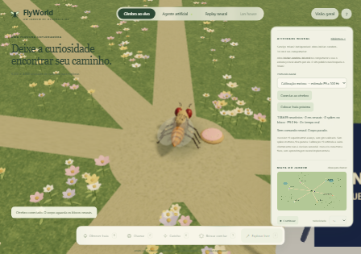

# Cérebro ao vivo no jardim 3D

O modo inicial **Cérebro ao vivo** conecta o navegador ao simulador Brian2
Python local. Usa a rede completa do repositório: 138.639 neurônios e a
conectividade original, com estado persistente entre blocos de 20 ms.
Não usa os arquivos de replay para produzir comandos.

## Iniciar

Com as dependências Python e `npm ci` da pasta `web` instaladas, execute
`iniciar-cerebro-3d.cmd` na raiz. Ele compila a interface, inicia o serviço
em `http://127.0.0.1:8765` e abre o jardim. Mantenha o terminal aberto.
Ctrl+C encerra o serviço e o processo neural. Para iniciar sem abrir janela:

```powershell
.\.venv\Scripts\python -m flyworld.neural_service --no-browser
```

O serviço serve o próprio `web/dist`, permitindo comunicação na mesma origem.
Escuta somente em loopback, rejeita origens externas e não aceita caminhos de
dados nem código enviados pelo navegador. Não é um servidor público de produção.
A publicação Vercel contém a interface, mas não executa o Brian2; abra o endereço
local para usar o cérebro. Sem serviço, o modo neural aguarda, sem movimento.

## Circuito implementado

1. O sensor geométrico mede proximidade de alimento entre 0 e 1.
2. Essa intensidade modula a fonte Poisson dos 21 Sugar GRNs definidos no
   experimento original, até 200 Hz. Não recebe coordenadas de destinos.
3. Brian2 calcula um bloco da rede inteira, preservando potenciais e sinapses.
4. O decoder experimental calcula a taxa dos dois P9 e a divide por 100 Hz,
   limitada entre 0 e 1, para gerar avanço. O comando de giro é zero.
5. Só esse bloco avança a física pelo mesmo intervalo neural. A colisão apenas
   impede atravessar sólidos; não escolhe desvios ou destinos.

Setas, convites, respostas lúdicas, Q-learning e entrada na lan house são
desativados nesse modo. **Colocar fruta próxima** altera o ambiente sensorial,
sem dar comandos motores. O agente artificial e Pong permanecem disponíveis
como modos explicitamente separados; selecionar **Agente artificial** os libera.

Sem spikes P9 o comando é zero, mesmo se houver muitos spikes em outros
neurônios. Pausa, ajuda ou aba oculta interrompem novos pedidos; um bloco já
em cálculo pode terminar e aguarda a retomada. Desconexão congela o corpo;
nenhuma política artificial assume o controle. Uma solicitação por vez evita
acumular blocos atrasados. Os blocos podem continuar disponíveis no serviço
quando se troca de modo; não há atualização do corpo fora do modo neural.

## Calibração motora

O seletor **Calibração motora → estímulo P9 a 100 Hz** recria a rede com o
experimento P9 original e estimula diretamente os dois neurônios de saída.
Comprova o caminho spikes → decoder → corpo, mas **não demonstra que alimento
provoca marcha**, nem que a mosca escolheu andar. Voltar ao protocolo sensorial
recria a rede com Sugar GRNs. Reconectar o mesmo protocolo preserva sua rede.

## Limites e evidência

Ainda não existe mapeamento validado de visão, olfato, toque ou comandos de giro,
nem plasticidade sináptica implementada. Não se afirma exploração independente,
aprendizagem neural ou capacidade de jogar Pong pelo conectoma. O decoder P9 é
uma hipótese de engenharia, não um modelo completo dos circuitos motores.

No ensaio da rede completa em 22/10/2026:

| Protocolo | Intervalo neural | Spikes totais | Spikes P9 | Resultado |
| --- | --- | --- | --- | --- |
| Sugar GRNs, intensidade 1 | 100 ms | 1.523 | 0 | Comando zero |
| P9, intensidade 1 | 100 ms | 28 | 13 | Avanço em quatro dos cinco blocos |

Cada bloco de 20 ms levou aproximadamente 2,1–2,8 segundos de CPU nesse ensaio.
O jardim respeita esse relógio lento. O painel apresenta população, spikes,
taxa P9, intensidade, comando e fator de tempo real.

Com Chromium renderizando por software ao mesmo tempo, os blocos ficaram mais
lentos: o ensaio de navegador registrou 10,26 s para o bloco sensorial observado
e 6,51 s para o primeiro bloco P9. Esses tempos variam com a carga da máquina;
não há promessa de tempo real. O teste limita sua própria renderização para
reduzir disputa de CPU e não mede desempenho de uma GPU dedicada.

Os resultados brutos estão em [NEURAL_INTEGRATION.json](NEURAL_INTEGRATION.json)
e [NEURAL_BROWSER_VALIDATION.json](NEURAL_BROWSER_VALIDATION.json). O segundo
comprovou deslocamento do corpo, setas ignoradas, Q inalterado e corpo parado
durante pausa e erro de conexão, sem erros JavaScript.



`flyworld-output/neural-live/blocks.jsonl` registra os blocos reais, incluindo IDs
P9 como strings para não perder precisão de inteiros no JavaScript. Essa pasta
é local e ignorada pelo Git. Não se alteram pesos do conectoma.

## Verificação

```powershell
.\.venv\Scripts\python -m pytest -q
cd web
npm test
npm run build
# Com o serviço local ativo; usa Brian2 real, sem mocks:
node neural-smoke.mjs
```

Os testes unitários verificam silêncio motor, contagens P9, intensidade sensorial,
fila limitada, troca de protocolo, erros e barreira HTTP. O ensaio de navegador
verifica spikes sensoriais, movimento por P9, ausência de aprendizagem Q e
controle manual, pausa, perda de conexão, transições e interface móvel.

O aplicativo Pygame anterior permanece disponível: nele, `autonomous` continua
usando Q-learning com observador, e `live` usa o decoder experimental. O circuito
descrito aqui pertence ao novo serviço e ao jardim Three.js.
